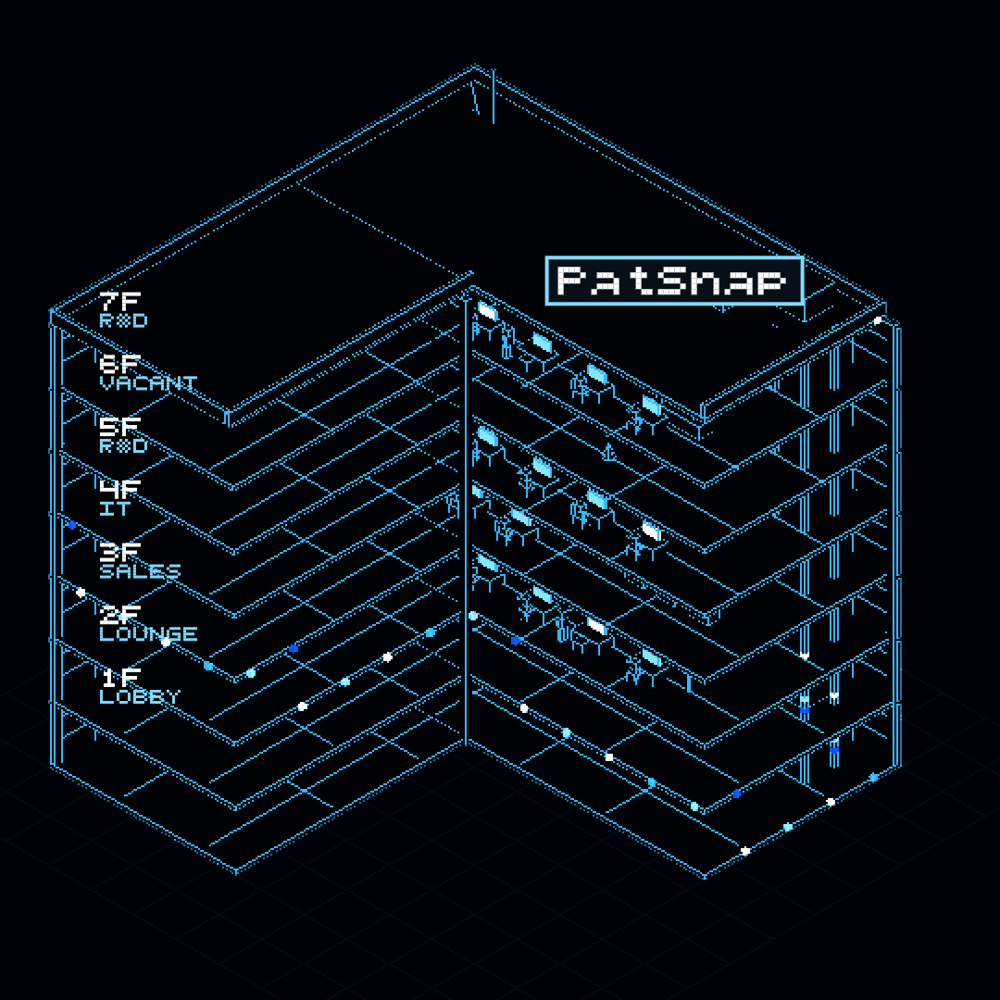

# 像素公司 / Pixel Office

智慧芽（PatSnap）苏州新办公室大堂用的 1:1 正方形屏幕原型。画面是一栋用 three.js 搭的 7 层剖切楼：正交相机放在等距角上，楼体是实心盒子（楼板、两面后墙、柱、楼梯、电梯），近侧两面墙拆掉，楼板近角切成 L。屋顶有 **PatSnap** 字牌。

画面是全息蓝图风格：近黑底，楼体用深海军蓝填充，棱线是浅冰蓝（`#7FDBFF`）。低分辨率画完后再用最近邻放大，所以看起来是像素图。电流沿楼板边缘走（`#BFF4FF` ↔ `#2E9BFF`）。强调色只有白色（字牌、屏幕、楼层铭牌）。



## 本地运行

需要 Node.js 20 或更高版本。

```bash
npm install
npm run dev
```

浏览器打开 [http://localhost:5173](http://localhost:5173)。开发服务监听 `0.0.0.0:5173`，同一局域网里的大屏电脑也可以访问。

## 构建与预览

```bash
npm run build
npm run preview
```

`preview` 默认端口 `4173`。产物在 `dist/`，可以放到任意静态文件服务器上。

## 改楼层

所有楼层都在 [`src/config/floors.ts`](src/config/floors.ts)。改完保存，开发服务器会自动刷新。

| 字段 | 作用 |
| --- | --- |
| `level` | 楼层号。`1` 在最底下，数字越大越靠上。请保持 1–7 且不要重复。 |
| `type` | 室内模板：`lobby` 门厅、`lounge` 休息区、`sales` 销售、`it` 机房、`rnd` 研发、`vacant` 空置。换 `type` 就会换成那一套家具。 |
| `label` | 侧面大字，例如 `3F`。只用 A–Z、0–9 和 `& - ! +` 空格。 |
| `name` | 侧面小字，例如 `SALES`。空置层用 `VACANT`。 |
| `title` | 给人看的中文说明，不会画到屏幕上。 |
| `stations` | 办公层工位数，建议 16–24。工位按这个数量摆，超出楼板的不会再加。 |
| `occupancy` | 这些工位有人坐着的比例，建议 `0.4`–`0.6`。 |
| `people` | 不坐工位的额外人数：访客、踱步、休息区聊天。 |

事件跟着 `type` 走：成交在销售层，部署成功在研发层，访客到达在门厅层。较高的那层 `rnd` 会多一块白板 / 实验台，用来和另一层研发区分开。

## 事件

现在用的是假轮询：大约每 10–30 秒随机抛出一条事件，几秒后回到平时状态。

接口在 [`src/events/source.ts`](src/events/source.ts)：

- `dealClosed` — 销售层有人庆祝，弹出 `DEAL`
- `deploySuccess` — 研发层屏幕闪白，弹出 `DEPLOY`
- `visitorArrived` — 门厅有人从门口走进来

换成真实数据时，实现同一个 `EventSource`（`start` / `stop`），然后在 [`src/main.ts`](src/main.ts) 里把 `createMockEventSource(...)` 换成你的实现即可。例如以后接 WebSocket：

```ts
export function createSocketSource(url: string): EventSource {
  let socket: WebSocket | null = null;
  return {
    start(onEvent) {
      socket = new WebSocket(url);
      socket.onmessage = (message) => {
        const data = JSON.parse(String(message.data)) as {
          type: 'dealClosed' | 'deploySuccess' | 'visitorArrived';
          level: number;
          ttlMs?: number;
        };
        onEvent({
          type: data.type,
          level: data.level,
          ttlMs: data.ttlMs ?? 5500,
          at: performance.now(),
        });
      };
    },
    stop() {
      socket?.close();
      socket = null;
    },
  };
}
```

## 显示

画面是正方形。窗口不是正方形时，四周用同一近黑色留边。three.js 先画到较低分辨率，再用最近邻放大（`RenderPixelatedPass`，像素大小按屏幕边长 / 540 取整）。CSS 使用 `image-rendering: pixelated`。

楼体、棱线和工位在启动时合并或实例化。帧循环只改小人、电梯、屏幕颜色和电流位置，不创建、不销毁几何体，并且把刷新压在 30 帧。适合 7×24 小时挂着。

## 防烧屏与昼夜

大约每 15 分钟，整幅画面在 ±2 像素内挪一格，避免静态线条长期烧在同一批面板像素上。

色调按苏州时间（东八区，无夏令时）轻微变化：傍晚稍深，夜里再压一点。字牌仍然保持白色。

## Chrome 展厅模式

先构建再预览（或由系统服务托管 `dist/`）：

```bash
npm run build
npm run preview -- --host 0.0.0.0 --port 4173
```

在大屏那台电脑上：

```bash
google-chrome \
  --kiosk \
  --no-first-run \
  --disable-infobars \
  --disable-session-crashed-bubble \
  --autoplay-policy=no-user-gesture-required \
  "http://127.0.0.1:4173/?kiosk=1"
```

`?kiosk=1` 会隐藏鼠标并禁用右键菜单。建议在操作系统里关掉屏保和自动休眠。WebGL 上下文如果丢失，页面会自动刷新。

## 调试参数

| 参数 | 作用 |
| --- | --- |
| `?demo=1` | 很快依次播放访客、成交、部署，方便看庆祝动画 |
| `?hour=22` | 强制按这个小时上色（0–23），不跟真实时间走 |
| `?kiosk=1` | 展厅模式：无鼠标 |
| `?burn=fast` | 防烧屏每 3 秒挪一次，用来确认位移 |

## 技术说明

Vite + TypeScript + three.js。平面是 20×20 的正方形，层高大约 2.55。正交相机在真等距角上。每层楼板是 L 形，近角切掉。人和家具是海军蓝填充加冰蓝棱线，亮色只留给屏幕和机柜灯。楼层名按该层左墙的三维位置投到画面上，屋顶的 PatSnap 画在同一张清晰叠层上。像素感来自官方的 `RenderPixelatedPass`。旧的 2D 绘制还留在 `src/render/` 里，默认入口不再使用它。没有使用第三方像素素材。
